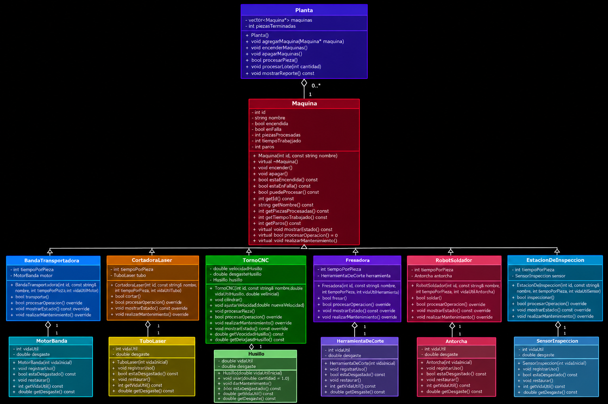
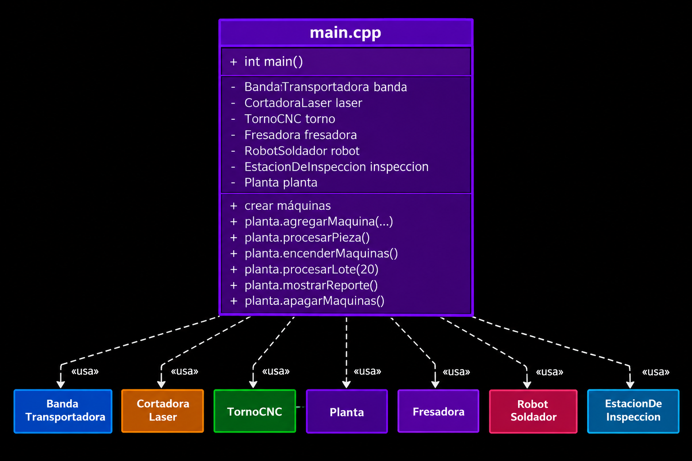

# Simulador de una Planta de Manufactura Automatizada

Proyecto del Parcial 2 de Programación Orientada a Objetos.

## 1. Equipo

| Bloque | Matrícula | Nombre | Usuario de GitHub | Máquina | Componente |
| --- | --- | --- | --- | --- | --- |
| 1 |24090|Luis Samano Saavedra |LuisSaSa4 |Robot Soldador |Antorcha|
| 2 |25104|Diego Emilio Simental Perez|@simentalinho |Torno CNC |Husillo |
| 3 |25111 |Renata Lucia Farias Esquivel|renatafarias-lang |Banda Transportadora |Motor|
| 4 | |Mary Ator Garang |marygarang-a11y |Cortadora Laser |Tubo laser |
| 5 |25218 |Néstor Hiram López Valdovinos |nestor-lopez-07 |Fresadora |Herramienta de corte |
| 6 |25128 |Diego Jimenez Mena |Mena18-IME |Estación de Inspección |Sensor |

## 2. Orden de la línea
1. Banda transportadora
2. Cortadora láser
3. Torno CNC
4. Fresadora
5. Robot soldador
6. Estación de inspección

## 3. Cómo compilar y ejecutar

Desde la carpeta raíz del proyecto, en una terminal con `g++` disponible:

**Compilar:**

```bash
g++ -Wall -Wextra -std=c++17 -Iinclude src/*.cpp -o planta
```

**Ejecutar:**

```bash
./planta
```

## 4. Reglas de la simulación

**¿En qué momento exacto falla una máquina?**

La falla se registra al terminar de procesar la pieza que agota la vida útil del componente. Esa pieza cuenta como procesada; la máquina queda en falla y, si hay otra pieza que procesar, la planta realiza mantenimiento antes de continuar. Si la falla ocurre en la última pieza del lote, no se realiza mantenimiento porque ya no hay otra pieza que requiera procesamiento.

**¿El mantenimiento suma tiempo al turno? ¿Cuánto?**

No. El mantenimiento no agrega segundos al tiempo trabajado; se registra como un paro de la máquina.

## 5. Cálculo a mano del reporte

Lote de 20 piezas, con los tiempos y límites configurados en `src/main.cpp`. Cada vida útil se restaura durante el mantenimiento.

| Máquina | Segundos por pieza | Límite del componente | Fallas en 20 piezas | Tiempo trabajado |
| --- | --- | --- | --- | --- |
| Banda transportadora | 4 | Motor: 7 piezas | 2 (después de las piezas 7 y 14) | 20 × 4 = 80 s |
| Cortadora láser | 12 | Tubo láser: 6 piezas | 3 (después de las piezas 6, 12 y 18) | 20 × 12 = 240 s |
| Torno CNC | 30 | Husillo: 10 piezas | 2 (después de las piezas 10 y 20) | 20 × 30 = 600 s |
| Fresadora | 8 | Herramienta de corte: 5 piezas | 4 (después de las piezas 5, 10, 15 y 20) | 20 × 8 = 160 s |
| Robot soldador | 6 | Antorcha: 9 piezas | 2 (después de las piezas 9 y 18) | 20 × 6 = 120 s |
| Estación de inspección | 5 | Sensor: 10 piezas | 2 (después de las piezas 10 y 20) | 20 × 5 = 100 s |

**Reporte esperado (piezas terminadas, tiempo total y paros):**

20 piezas terminadas, 1300 s de trabajo y 12 paros por mantenimiento: 2 de la banda, 3 de la cortadora láser, 1 del torno, 3 de la fresadora, 2 del robot y 1 de la estación de inspección. La fresadora, el torno y la estación de inspección terminan en falla porque agotan el componente durante la pieza 20; esa pieza se completa y no hace falta otro mantenimiento al final del lote.

**¿Coincide con lo que imprime el programa? Si no coincidió al primer intento, ¿qué encontraron?**

No coincidió al primer intento porque tuvimos errores al unir las máquinas con la planta. Después de corregirlos, el reporte salió como esperábamos: 20 piezas, 1300 segundos y 12 paros.

## 6. Diagrama general

Diagramas generales de clases de la solución completa:





## 7. Documentación individual

| Integrante | Documentación de su clase | Propuesta de mejora |
| --- | --- | --- |
| Néstor Hiram López Valdovinos | [Fresadora](docs/mejoras/25218/Fresadora.md) | [Propuesta](docs/mejoras/25218/Mejora.md) |
| Luis Samano Saavedra | [RobotSoldador](docs/mejoras/24090/RobotSoldador.md) | [Propuesta](docs/mejoras/24090/mejora.md) |
| Diego Jiménez Mena | [Estacion_inspeccion](docs/mejoras/25128/Estacion_inspeccion.md) | [Propuesta](docs/mejoras/25128/Mejora.md) |
| Diego Simental | | [Propuesta](docs/mejoras/25104/mejora.md) |
| Renata Lucia Farias Esquivel | [BandaTransportadora](docs/mejoras/25111/BandaTransportadora.md) | [Propuesta](docs/mejoras/25111/MejorasBandaTransportadora.md) |

## 8. Cambios a `Maquina.h`

Se agregó el método virtual puro `procesarOperacion()` para que `Planta` pueda solicitar el procesamiento de manera polimórfica. Cada máquina concreta implementa esa operación usando su método propio.
