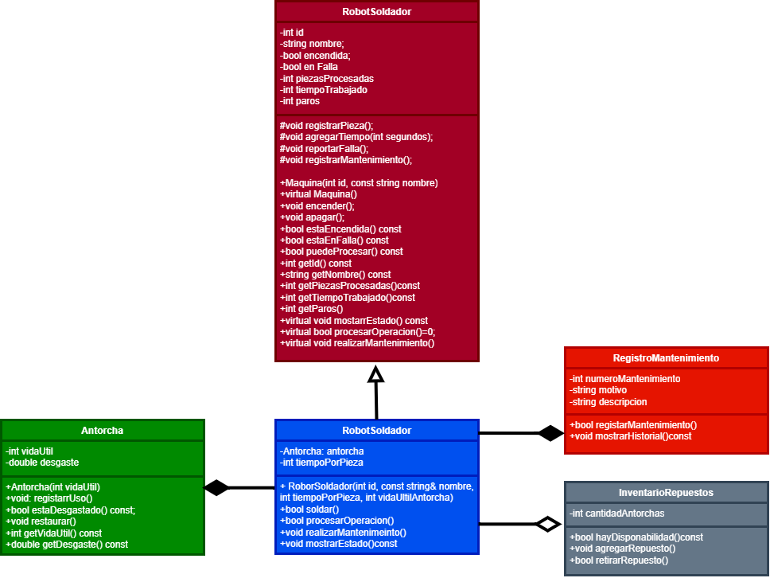

# Propuesta de mejora: 

> Crea una carpeta dentro de `docs/mejoras/` con tu número de matrícula como nombre, copia este archivo ahí como `mejora.md` y llena tu copia. No modifiques la plantilla.
>
> La propuesta es solo diseño: no se programa.

**Propuesta de mejora elaborada por:** Luis Samano Saavedra

 

## 1. Impacto

**¿Es una mejora o una corrección?**

Es una mejora, porque se propone agregar nuevas funcionalidades para administrar el mantenimiento del robot soldador y llevar un registro de las actividades realizadas sobre sus componentes.

 

**¿Qué observaste en la solución del equipo que dio origen a la propuesta?**

Se observó que el robot soldador puede detectar fallas relacionadas con el desgaste de la antorcha y realizar su mantenimiento. Sin embargo, el diseño actual se concentra en restaurar el componente para continuar trabajando y no contempla un objeto independiente que administre el historial de mantenimientos ni otro que represente los repuestos disponibles.

 

**¿Qué mejora o qué corrige, y por qué vale la pena?**

La propuesta consiste en incorporar dos clases nuevas: RegistroMantenimiento e InventarioRepuestos.

La clase RegistroMantenimiento permitiría almacenar información de cada mantenimiento realizado al robot soldador, como el motivo, la descripción del trabajo y el número de mantenimiento.

La clase InventarioRepuestos permitiría controlar la cantidad de antorchas de repuesto disponibles. Cuando una antorcha necesitara ser reemplazada por desgaste o daño, el sistema podría consultar si existe un repuesto disponible y registrar su utilización.

Esta mejora permitiría separar las tareas de mantenimiento y administración de repuestos de la operación de soldadura, haciendo que el diseño sea más organizado y ampliable.

 

## 2. Qué implica

**Clases nuevas:**

Se agregarían las siguientes clases:

RegistroMantenimiento: almacena la información de los mantenimientos realizados al robot soldador. Podría incluir atributos como numeroMantenimiento, motivo y descripcion, además de métodos para registrar y mostrar los mantenimientos.

InventarioRepuestos: administra la cantidad de antorchas de repuesto disponibles. Podría incluir un atributo cantidadAntorchas y métodos para consultar la disponibilidad, agregar repuestos y registrar la salida de una antorcha del inventario.

 

**Comportamiento nuevo en clases existentes:**

La clase RobotSoldador podría consultar el inventario cuando fuera necesario reemplazar la antorcha y registrar cada mantenimiento realizado mediante un objeto RegistroMantenimiento.

La clase Antorcha conservaría la responsabilidad de registrar su desgaste, determinar si ha alcanzado su límite de uso y restaurar su desgaste cuando se realice un mantenimiento que permita reutilizarla.

Si la antorcha no pudiera reutilizarse, el sistema podría consultar el inventario para determinar si hay un repuesto disponible.

 

**Interacciones nuevas entre objetos:**

1.- RobotSoldador detecta una falla relacionada con la antorcha.

2.- El robot solicita registrar el mantenimiento mediante RegistroMantenimiento.

3.- Si la antorcha puede restaurarse, se realiza el mantenimiento correspondiente.

4.- Si necesita reemplazarse, el robot consulta InventarioRepuestos.

5.- Si hay una antorcha disponible, el inventario registra la salida del repuesto y el robot puede continuar después de instalarlo.

6.- El historial conserva la información del mantenimiento realizado.

Estas interacciones permitirían distinguir entre restaurar un componente y reemplazarlo por uno nuevo.

 

**Relaciones nuevas (herencia, composición o agregación) y por qué son de ese tipo:**

Se propone conservar las relaciones existentes:

1.- Herencia: RobotSoldador hereda de Maquina, porque es un tipo específico de máquina y reutiliza sus características generales.

2.- Composición: RobotSoldador contiene una Antorcha, porque este componente forma parte de su estructura y participa directamente en la operación de soldadura.

Se agregarían las siguientes relaciones:

Composición entre RobotSoldador y RegistroMantenimiento: el robot tendría un objeto encargado de administrar su historial de mantenimiento, el cual formaría parte de su diseño.

Agregación entre RobotSoldador e InventarioRepuestos: el robot consultaría un inventario administrado de forma independiente. El inventario podría existir aunque el robot soldador no estuviera presente.

Estas relaciones permitirían separar las responsabilidades y facilitar futuras ampliaciones del sistema.

 

## 3. Diagrama de clases

Diagrama hecho en draw.io que muestre la solución con la mejora incorporada. Distingue lo nuevo de lo existente, por ejemplo con otro color. Guarda la imagen en esta misma carpeta y enlázala aquí.

