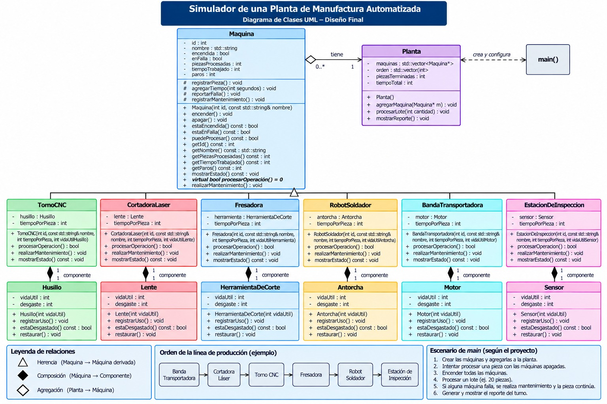

**Propuesta de mejora elaborada por:** [Diego Simental]

## 1. Impacto

**¿Es una mejora o una corrección?**

Es una mejora orientada a incorporar un sistema de mantenimiento preventivo y gestión de inventario en proceso, encuanto a lo que me tocó hacer, es una mejora orientada a optimizar la fidelidad del modelo físico y el control de desgaste en el sistema de torneado.

**¿Qué observaste en la solución del equipo que dio origen a la propuesta?**

El husillo actual incrementa un desgaste fijo de una unidad por cada pieza procesada sin tomar en cuenta variables reales de operación como la velocidad de corte o el esfuerzo mecánico.

**¿Qué mejora o qué corrige, y por qué vale la pena?**

Mejora el cálculo del desgaste haciéndolo proporcional a la exigencia del mecanizado, lo cual vale la pena para lograr una simulación de mantenimiento predictivo mucho más realista en la celda de manufactura.

## 2. Qué implica

**Clases nuevas:**

Se integra una clase auxiliar para gestionar los perfiles de velocidad y los parámetros dinámicos del material torneado.

**Comportamiento nuevo en clases existentes:**

El torno y el husillo procesan el desgaste de forma variable segun la intensidad de la operación de cilindrado en lugar de sumar un incremento estático.

**Interacciones nuevas entre objetos:**

El torno consulta de forma directa las condiciones de carga al husillo antes de validar y registrar cada ciclo de uso.

**Relaciones nuevas (herencia, composición o agregación) y por qué son de ese tipo:**

Se conserva la composición estricta entre TornoCNC y Husillo por ser una relación de pertenencia directa, incorporando una asociación hacia los nuevos parámetros para mantener el encapsulamiento del diseño orientado a objetos.

## 3. Diagrama de clases

Diagrama hecho en draw.io que muestre la solución con la mejora incorporada. Distingue lo nuevo de lo existente, por ejemplo con otro color. Guarda la imagen en esta misma carpeta y enlázala aquí.

