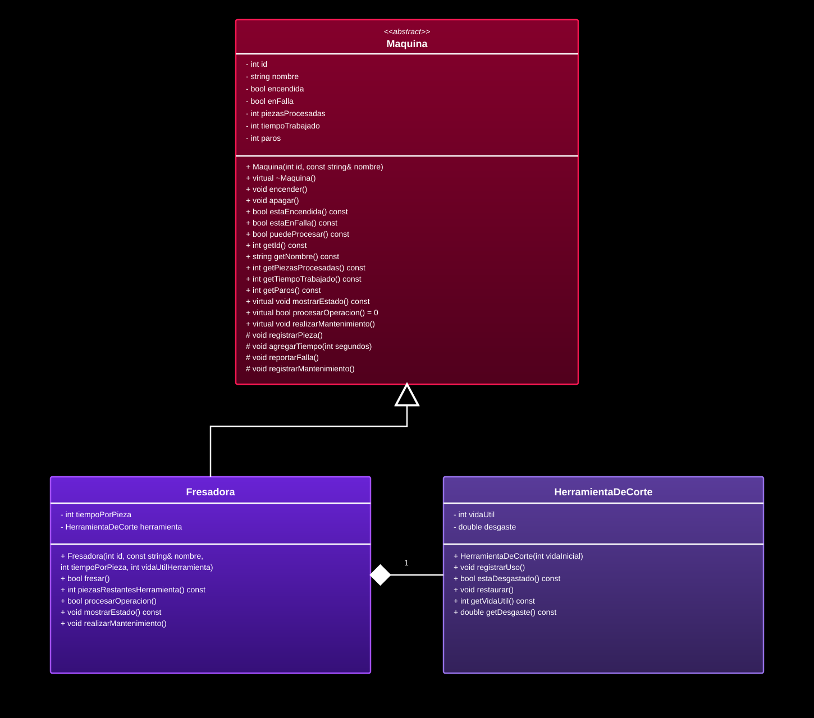

# Documentación de la clase: Fresadora

> Copia este archivo como `docs/<Clase>.md` 

**Elaborada por:** Néstor Hiram López Valdovinos
 
**Matrícula:** 25218
 
**Bloque:** 5

## 1. Propósito

**¿Qué máquina representa tu clase y qué operación hace sobre la pieza?**

Representa una fresadora. Su operación es ranurar o fresar la pieza; el tiempo de trabajo por pieza se configura al crear la máquina.

**¿Cuál es su componente y por qué no existe sin la máquina?**

Su componente es `HerramientaDeCorte`, que se desgasta con cada pieza fresada. La fresadora la contiene como atributo por valor, así que se construye con la máquina y su ciclo de vida queda ligado al de esta; representa la herramienta instalada que necesita para ranurar.

## 2. Decisiones de diseño

**Atributos propios de tu clase y validación de cada uno:**

`tiempoPorPieza` guarda los segundos que tarda el fresado y el constructor rechaza valores menores o iguales a cero mediante `std::invalid_argument`. `herramienta` es el componente compuesto y recibe `vidaUtilHerramienta`; el constructor de `HerramientaDeCorte` también rechaza una vida útil menor o igual a cero. La clase base almacena el identificador y el nombre; esta clase no añade validación para esos dos parámetros.

**Métodos propios (los que la clase base no tiene):**

`fresar()` es el método propio de la fresadora: realiza la operación y devuelve `true` si procesa la pieza, o `false` si la máquina no está disponible o la herramienta ya llegó al límite. `procesarOperacion()` no es un método nuevo de la clase: sobrescribe la operación virtual pura de `Maquina` y delega en `fresar()`, permitiendo que la planta use una interfaz común para máquinas distintas.

**Método de la base que redefines, y cómo reutilizas la versión de la base:**

`procesarOperacion()`, `mostrarEstado()` y `realizarMantenimiento()` sobrescriben métodos virtuales de `Maquina`. `procesarOperacion()` delega el trabajo en `fresar()`. `mostrarEstado()` llama primero a `Maquina::mostrarEstado()` y después presenta el tiempo por pieza, la vida útil y el desgaste de la herramienta. `realizarMantenimiento()` no hace nada si la fresadora no está en falla; si lo está, restaura la herramienta y llama a `Maquina::realizarMantenimiento()` para quitar la falla y registrar un paro.

**¿Cómo modelaste el desgaste del componente y por qué así?**

Cada pieza procesada suma una unidad de desgaste a la herramienta. Al llegar al límite de vida útil, la pieza actual termina de procesarse y la fresadora registra la falla; no puede procesar la siguiente hasta recibir mantenimiento. El mantenimiento reinicia el desgaste a cero.

**¿Qué usa tu clase de `Maquina` y qué agrega?**

Usa el estado general y los métodos heredados: `puedeProcesar()` para comprobar si está disponible; `registrarPieza()` y `agregarTiempo()` para actualizar la producción; `reportarFalla()` para registrar que la herramienta llegó a su límite; `getNombre()` para mostrar mensajes; y `Maquina::mostrarEstado()` y `Maquina::realizarMantenimiento()` para reutilizar el comportamiento general. Agrega el tiempo por pieza, la herramienta compuesta y la operación de fresado con su gestión de desgaste.

## 3. Diagrama

## 4. Bitácora

**Dudas que tuviste y cómo las resolviste:**

Una decisión fue determinar cuándo registrar la falla: se registra después de que se completa la pieza que agota la herramienta. El mantenimiento de la fresadora se solicita aparte; el método de fresado no lo ejecuta automáticamente.

**Errores que encontraste y cómo los corregiste:**

La declaración `override` de `procesarOperacion()` no coincidía inicialmente con la interfaz de `Maquina`. Se corrigió agregando en la clase base la operación virtual pura `procesarOperacion()` y haciendo que las máquinas derivadas la implementen.
