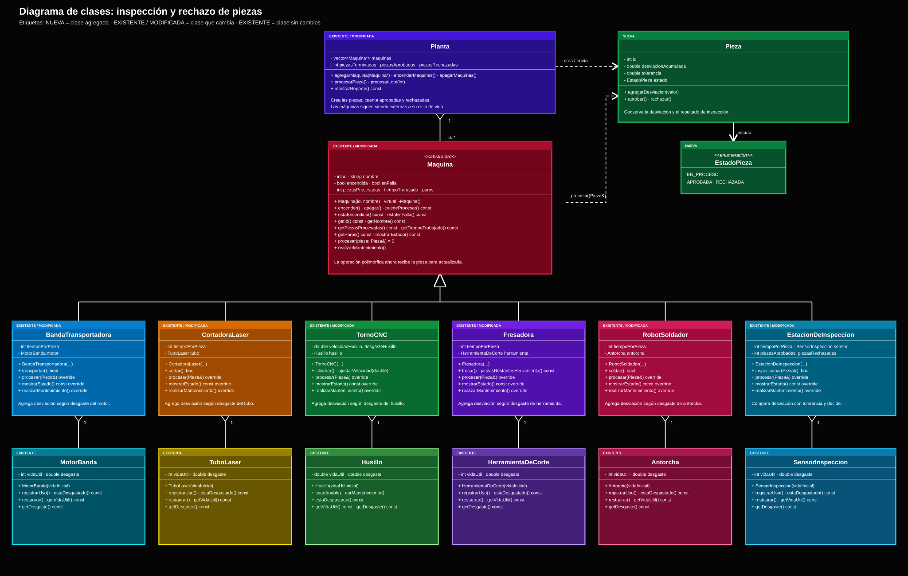

# Propuesta de mejora:Rechazo de piezas después de la Estación de inspección

>
> La propuesta es solo diseño: no se programa.

**Propuesta de mejora elaborada por:** Néstor Hiram López Valdovinos 

## 1. Impacto

**¿Es una mejora o una corrección?**

Es una corrección. La planta sí tiene una Estación de inspección, pero no hace nada útil con lo que mide.

**¿Qué observaste en la solución del equipo que dio origen a la propuesta?**

Al revisar nuestra solución me di cuenta de que la Estación de inspección solamente mide la pieza, pero ese resultado no cambia nada. Ni siquiera existe la pieza como objeto: solo llevamos un contador

**¿Qué mejora o qué corrige, y por qué vale la pena?**

Hace que la inspección sí cumpla su trabajo donde aprueba o rechaza cada pieza, el desgaste de los componentes ya no solo causa fallas, también afecta la calidad de lo que se fabrica.
## 2. Qué implica

**Clases nuevas:**

***Pieza:*** Representa cada pieza del lote como un objeto propio, para poder saber si salió bien o mal.

***EstadoPieza:*** Define los estados posibles de una pieza en proceso, aprobada o rechazada para que no tenga dos a la vez.

**Comportamiento nuevo en clases existentes:**

| Clase | Qué cambia |
|---|---|
| Maquina | procesar ahora recibe la pieza: procesar(Pieza&). Como esto toca Maquina.h, se documenta en el README con acuerdo del equipo. |
| Máquinas derivadas | Al procesar una pieza, le suman desviación según el desgaste de su componente: entre más piezas lleva desde su último mantenimiento, más error le agrega. Cuando recibe mantenimiento, ese conteo vuelve a cero. |
| EstacionInspeccion | Redefine procesar(Pieza&): usa la versión de la base, compara la desviación total de la pieza con su tolerancia y la aprueba o la rechaza. Cuenta las piezas aprobadas y rechazadas. |
| Planta | Crea cada pieza, la pasa por las estaciones y descarta las rechazadas. Lleva la cuenta de aprobadas y rechazadas. |
| Reporte del turno | Agrega piezas aprobadas, rechazadas y porcentaje de rechazo. |
 

**Interacciones nuevas entre objetos:**

La `Planta` crea una `Pieza` por cada unidad del lote y la pasa por las máquinas, en orden. Cada máquina agrega un valor a la desviación de la pieza según el desgaste de su componente. La desviación se acumula durante todo el recorrido.

Al llegar a la `EstacionDeInspeccion`, se compara la desviación con la tolerancia permitida. Si no la supera, la pieza se aprueba; si la supera, se rechaza. La `Planta` cuenta ambos resultados y descarta las piezas rechazadas. Al final del lote, muestra cuántas piezas aprobó y rechazó, y el porcentaje de rechazo.

**Relaciones nuevas (herencia, composición o agregación) y por qué son de ese tipo:**

`EstadoPieza` indica en qué etapa está una pieza: en proceso, aprobada o rechazada. `Pieza` guarda ese estado. No se crea una clase heredada ni un objeto separado para representarlo.

Las máquinas siguen heredando de `Maquina`, como ya lo hacen. El cambio es que su operación recibe la pieza (`procesar(Pieza&)`) para poder actualizarla. La estación de inspección también hereda de `Maquina` y usa esa operación para aprobar o rechazar la pieza.

`Planta` mantiene una lista de máquinas, pero no es responsable de crearlas ni destruirlas; por eso, esa relación es de agregación. La planta crea las piezas y las pasa a las máquinas para que las procesen. Las máquinas solo las usan durante el recorrido, no son sus dueñas; por eso, no hay composición entre `Maquina` y `Pieza`. Las máquinas conservan la composición con sus componentes, porque cada componente forma parte de su máquina.

## 3. Diagrama de clases

